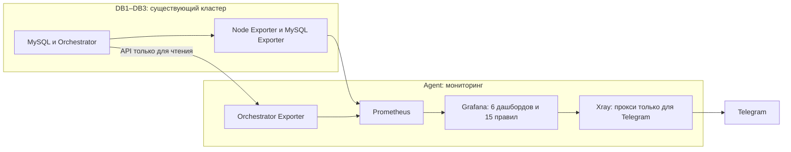

# Мониторинг MySQL-кластера с Ansible

Ansible-проект разворачивает Prometheus, Grafana, exporters и уведомления Telegram для **существующего** кластера MySQL Replication + Orchestrator. Текущий Primary определяется по метрикам и API Orchestrator, поэтому дашборды продолжают работать после переключения роли.

Проект не устанавливает MySQL и Orchestrator, не меняет репликацию и не управляет их контейнерами. На узлах БД создаётся отдельный Compose-проект `monitoring-exporters`, на Agent — проект `monitoring`.

## Схема



Xray нужен только там, где Agent не может обращаться к Telegram напрямую. На DB1–DB3 он не устанавливается.

## Требования

- Контроллер: Ansible Core, Python 3, SSH-доступ к Agent и трём DB-узлам.
- DB1–DB3: работающий Docker Engine с Compose plugin, существующие MySQL и Orchestrator; пользователь Ansible с правом `sudo`.
- Agent: Docker Engine с Compose plugin и `sudo`. На новом выделенном Agent с Ubuntu 24.04+ Docker можно установить отдельным разрешающим параметром.
- Сеть: Agent должен достигать Orchestrator API на DB-узлах и exporters на портах `9100` и `9104`. Grafana слушает `3000`, Prometheus — `9090`; ограничьте доступ к этим портам доверенной сетью средствами своей сетевой политики. Playbook не изменяет firewall.
- Отдельная SQL-учётная запись для MySQL Exporter на каждом DB-узле.

В [inventory/hosts.yml](inventory/hosts.yml) указаны адреса примера `10.100.0.1`–`10.100.0.4`. Перед запуском замените их и адреса Orchestrator API в [inventory/group_vars/all.yml](inventory/group_vars/all.yml) на свои.

## Быстрый старт

### 1. Настройте inventory

Проверьте SSH-пользователя, адреса, порты и список `orchestrator_api_urls` в `inventory/group_vars/all.yml`. Agent всегда подключается по SSH как отдельный host `agent`: запуск с другого контроллера не установит мониторинг на сам контроллер.

Если Telegram пока не нужен, установите в `all.yml`:

```yaml
telegram_enabled: false
telegram_vless_enabled: false
```

Для существующего MySQL в Docker `host` network discovery подберёт локальный адрес. При неоднозначном выборе контейнера или сети задайте `mysql_container_override` и `mysql_network_override` явно, при необходимости отдельно в `inventory/host_vars/db1.yml`, `db2.yml` и `db3.yml`.

### 2. Создайте SQL-пользователя exporter

Выполните вручную на каждом MySQL, указав разрешённый адрес клиента в соответствии с существующей Docker network:

```sql
CREATE USER 'exporter'@'<адрес клиента>' IDENTIFIED BY '<пароль>' WITH MAX_USER_CONNECTIONS 3;
GRANT PROCESS, REPLICATION CLIENT, SELECT ON *.* TO 'exporter'@'<адрес клиента>';
```

Ansible не выполняет SQL-команды и не создаёт этого пользователя. Пароль должен совпадать со значением в Vault. Не используйте глобальный host `%` без отдельного решения по сетевой безопасности.

### 3. Создайте и зашифруйте Vault

```bash
cp inventory/group_vars/vault.example.yml inventory/group_vars/vault.yml
$EDITOR inventory/group_vars/vault.yml
ansible-vault encrypt inventory/group_vars/vault.yml
```

Обязательно замените `CHANGE_ME` у `vault_mysql_exporter_password` и `vault_grafana_admin_password`. Если Agent использует отдельный пароль `sudo`, заполните `vault_agent_become_password`; при пустом значении или `CHANGE_ME` Ansible спросит его во время запуска. Для защищённого Orchestrator API заполните `vault_orchestrator_api_user` и `vault_orchestrator_api_password`.

`inventory/group_vars/vault.yml` добавлен в `.gitignore`. **Не публикуйте** токен бота, пароль или ссылку VLESS в README, issue, команде `-e` и истории shell.

### 4. Проверьте доступ и разверните мониторинг

```bash
ansible-playbook -i inventory/hosts.yml playbooks/access.yml --ask-vault-pass --ask-pass --ask-become-pass
ansible-playbook -i inventory/hosts.yml playbooks/site.yml --ask-vault-pass --ask-pass --ask-become-pass
```

При входе по SSH-ключу уберите `--ask-pass`. `--ask-become-pass` задаёт пароль `sudo` для DB1–DB3; пароль `sudo` Agent при необходимости запрашивается отдельно.

Если Docker отсутствует **только на новом выделенном Agent**, проверьте, что там нет существующего container runtime, и явно разрешите установку из пакетов Ubuntu:

```bash
ansible-playbook -i inventory/hosts.yml playbooks/site.yml --ask-vault-pass --ask-pass --ask-become-pass -e monitoring_install_docker_on_agent=true
```

Проект никогда не устанавливает Docker на DB1–DB3.

### 5. Проверьте результат

```bash
ansible-playbook -i inventory/hosts.yml playbooks/check.yml --ask-vault-pass
```

Откройте `http://<адрес Agent>:3000` и войдите с администраторскими данными Grafana. Проверка ожидает девять работающих Prometheus targets, три `mysql_up=1`, одну текущую Primary, шесть дашбордов и 15 правил.

## Telegram и VLESS

Для уведомлений задайте `telegram_enabled: true`, заполните `vault_telegram_bot_token` и `vault_telegram_chat_id` в Vault. Если прямой HTTPS к Telegram с Agent недоступен, также задайте `telegram_vless_enabled: true` и полную ссылку `vault_telegram_vless_uri` в Vault. Внутренний HTTP-прокси Xray направляет через VLESS только запросы к `api.telegram.org`; его порт на хост не публикуется.

Настройка Telegram на уже развёрнутом Agent:

```bash
ansible-vault edit inventory/group_vars/vault.yml
ansible-playbook -i inventory/hosts.yml playbooks/telegram.yml --ask-vault-pass --ask-pass --ask-become-pass
```

Есть интерактивный помощник `./scripts/enable_telegram_vless.sh`: он открывает Vault для редактирования и запускает тот же playbook. После настройки проверьте доставку кнопкой **Test** у contact point в Grafana.

Проект использует одну Telegram integration `mysql_cluster_telegram`. Текст сообщений короткий, на русском, без ссылок; каждое сработавшее правило отправляется отдельно. У 15 правил выдержка `for` равна 5 секундам, но реальная доставка после события дольше из-за интервалов сбора метрик (10–15 секунд), оценки правил (10 секунд) и сети. Краткие сбои при такой выдержке могут вызывать ложные тревоги.

## Обслуживание

| Задача | Команда |
|---|---|
| Проверить состояние без изменений | `ansible-playbook -i inventory/hosts.yml playbooks/check.yml --ask-vault-pass` |
| Обновить отдельные monitoring-проекты | `ansible-playbook -i inventory/hosts.yml playbooks/update.yml --ask-vault-pass --ask-pass --ask-become-pass` |
| Обновить правила и текст Telegram на Agent | `ansible-playbook -i inventory/hosts.yml playbooks/notifications.yml --ask-vault-pass --ask-pass --ask-become-pass` |
| Обновить интервалы и дашборды на Agent | `ansible-playbook -i inventory/hosts.yml playbooks/performance.yml --ask-vault-pass --ask-pass --ask-become-pass` |
| Обновить отображение после failover при недоступном DB-узле | `ansible-playbook -i inventory/hosts.yml playbooks/failover_view.yml --ask-vault-pass --ask-pass --ask-become-pass` |
| Проверить повторные Telegram integrations | `ansible-playbook -i inventory/hosts.yml playbooks/notification_audit.yml --ask-vault-pass --ask-pass` |

`notifications.yml` обновляет **существующий** contact point и сначала проверяет, что его integration одна. `performance.yml` включает этот playbook и дополнительно обновляет Prometheus и дашборды на Agent. `update.yml` обновляет DB exporters последовательно; существующие контейнеры MySQL и Orchestrator не перезапускаются.

## Локальная проверка проекта

```bash
bash scripts/qa.sh
```

Скрипт проверяет шаблоны и Compose-конфигурации, шесть дашбордов, 15 правил, код exporters и синтаксис playbooks с примерным Vault. Если установлен `ansible-lint`, он также запускается. Эта проверка не подтверждает доступность реальных серверов — для неё используйте `playbooks/check.yml`.

## Диагностика

| Симптом | Что проверить |
|---|---|
| Vault не расшифровывается | Пароль Vault и зашифрованный `inventory/group_vars/vault.yml`. |
| Agent отвергает `sudo` | На Agent под SSH-пользователем выполните `sudo -k && sudo -v`; при необходимости задайте отдельный пароль в Vault. |
| Orchestrator API не отвечает | Адреса и ACL от Agent до `/api/masters` на DB1–DB3; при HTTP 401/403 — существующие API credentials. |
| MySQL Exporter не выдаёт `mysql_up=1` | SQL-пользователя, его host-часть, пароль, права и выбранную Docker network. |
| Target `down` в Prometheus | Маршрут от Agent к DB-узлу и TCP `9100`/`9104`; playbook не открывает firewall. |
| Telegram Test возвращает HTTP 400 | `playbooks/telegram_diagnostics.yml`, затем `playbooks/telegram_grafana_diagnostics.yml`; не публикуйте их секреты. |

Provisioned дашборды и правила храните в файлах проекта: ручные изменения этих ресурсов в Grafana могут быть перезаписаны при следующем запуске Ansible.
